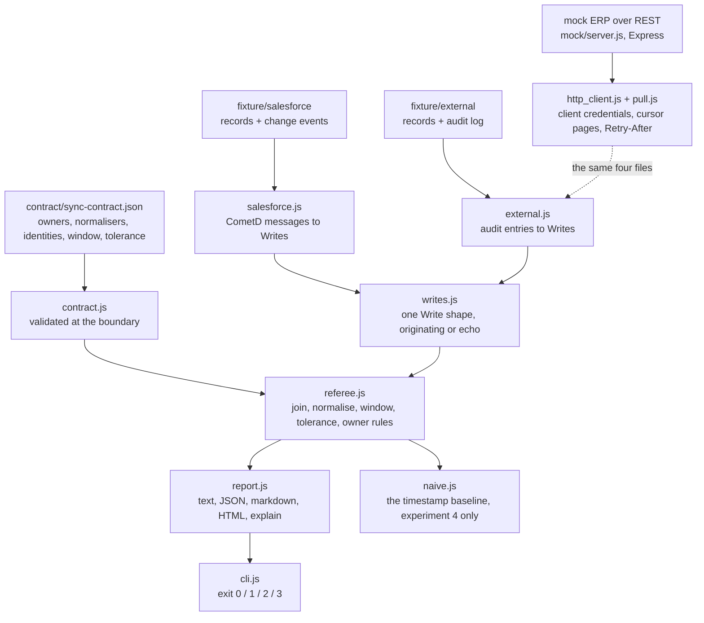
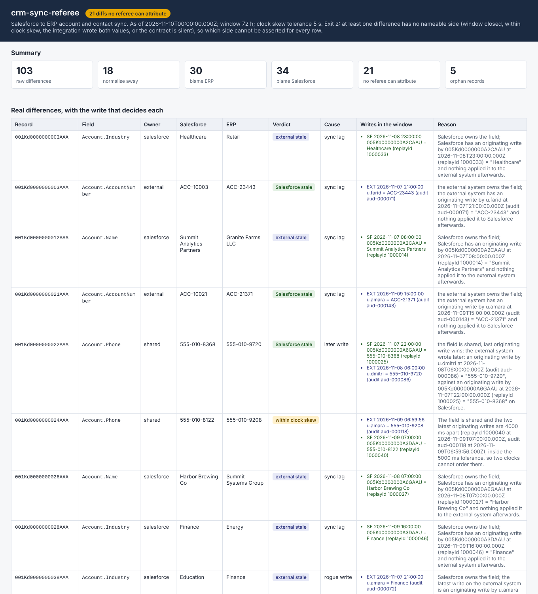

# crm-sync-referee

**Reads a Salesforce snapshot with its change events and an external system's snapshot with its audit log, and for every field that differs names the side that is stale, with the write that proves it, or says why no referee can.** Offline, no org, no runtime dependencies. Node 20 or later.

[](https://github.com/ManojKumarChunduru/crm-sync-referee/actions/workflows/ci.yml)

## The thing a diff cannot tell you

A field diff between Salesforce and an external system cannot say which side is stale, because the comparison is symmetric: a Salesforce write that never left and an external write that never arrived produce the same two values in the same two columns. Timestamps do not break the symmetry either. The integration writes into both systems under its own identity, so the latest write on a side is often the integration echoing the other side's older value, and the two clocks are not the same clock. What breaks it is a third implementation of the declared semantics, used as a referee: the sync contract (which system owns each field, which fields are shared last-writer-wins, how values are normalised before comparison, and which identities are the integration's own) replayed over the change log each side keeps. On the Salesforce side that log is Change Data Capture, which names the committing user and the API client of every change and is kept for three days. After that the evidence is gone, and the honest verdict is that no referee can say.

Four questions this answers that a diff, a `LastModifiedDate` comparison and a sync dashboard do not:

1. For each difference, which side should be overwritten, and which write proves it?
2. How many differences are the integration's own doing: an echo of a value the other side had already moved past, or a value it transformed on the way through?
3. How many are not differences at all once the contract's normalisers are applied, and how many has the contract never decided an owner for?
4. How many can no referee attribute, because the two writes are closer than the clocks can order or because the three-day event window has closed, and how many would an archive recover?

## The numbers, uncomfortable ones first

On the committed fixture (397 Salesforce records and 398 ERP records, 395 joined records, 14 contract fields, 2765 compared fields):

- **103 raw differences, of which 18 normalise away (17.5% of the raw count). 85 real diffs: 30 blame the ERP, 34 blame Salesforce, and 21 no referee can attribute (24.7% of real diffs unattributable).**
- **10 diffs outside the window: shared fields whose last originating writes on both sides are older than the 72 hours Salesforce keeps change events. An archive recovers 12 of the 21 (9 unattributable at 720 hours); legacy retention loses 17 more (38 unattributable at 24 hours).** The window is the single largest reason the referee cannot answer, and it is a property of the platform, not of the tool.
- **A timestamp comparison on the same fixture gets 56 rows wrong: 38 mis-attributed by timestamps (44.7% of real diffs mis-attributed), of which 17 name the wrong side (8 wrong on an echo, 9 wrong on a rogue write), 21 decided that cannot be decided, and 18 reported that were not differences.**
- 36 sync lag, 9 rogue writes, 6 echoes of a stale value, 8 later writes and 2 transformed on the way in among the attributed causes; 3 named by the contract alone, where the owner is declared but every write has expired.
- 4 within clock skew at the contract's 5-second tolerance (68 attributed at zero tolerance, 7 undecided pairs at 60 seconds); 4 transform verdicts where the integration wrote both values; 2 contract silent rows on the 2 fields with no declared owner; 1 gap event; 5 orphan records.

Credibility line: 185 tests, 98.5% line coverage, 103 of 103 recovered planted verdicts with 0 wrong verdicts, 0 false positives and 0 false negatives on a fixture the author wrote (floor 1 in 103). Every figure in this document is re-measured by `make verify` and checked against the prose by `tools/check_numbers.js`.

## Quickstart

Prerequisites: Node 20 or later, npm, git, make. No Salesforce CLI, no org, no network after `npm install`. The tests and the demo start the mock external system on a loopback port; nothing else opens a socket.

```bash
git clone https://github.com/ManojKumarChunduru/crm-sync-referee.git
cd crm-sync-referee
npm install          # dev dependencies only: express (the mock), eslint, c8
node bin/csr referee --salesforce fixture/salesforce --external fixture/external --contract contract/sync-contract.json   # exits 2 on this fixture
node bin/csr explain Contact.Title 003Kd0000000055AAA --salesforce fixture/salesforce --external fixture/external --contract contract/sync-contract.json
node bin/csr contract --contract contract/sync-contract.json
make verify          # lint, tests with coverage, experiments, receipts
```

The same referee over HTTP, against the mock ERP served from the fixture:

```bash
node mock/server.js --port 8089 &
node bin/csr pull --from http://127.0.0.1:8089 --client-id sf-sync-bridge --client-secret fixture-secret-not-a-secret --contract contract/sync-contract.json --out /tmp/erp
node bin/csr referee --salesforce fixture/salesforce --external /tmp/erp --contract contract/sync-contract.json
```

## Claim 1: the contract plus two change logs name the stale side where a diff cannot

Every verdict rests on three inputs: the owner the contract declares for the field, the writes to that field on each side inside the window, and whether each write was made by a person or by the integration (ADR-002). The rules, in the order `src/csr/referee.js` applies them:

| Owner | Evidence | Verdict | Cause |
| --- | --- | --- | --- |
| any | values equal after the contract's normalisers | not a diff | |
| Salesforce or ERP | the non-owner's latest write is a person's | non-owner stale | rogue write |
| Salesforce or ERP | the owner has an originating write the other side never received | non-owner stale | sync lag |
| Salesforce or ERP | the non-owner's latest write is an echo of a value the owner has since replaced | non-owner stale | echo of a stale value |
| Salesforce or ERP | the non-owner's latest write is an echo of a value the owner never held | non-owner stale | sync transform |
| Salesforce or ERP | no write on either side in the window | non-owner stale | window closed |
| shared | both sides have an originating write, further apart than the tolerance | the earlier side is stale | later write |
| shared | both sides have an originating write, inside the tolerance | within clock skew | |
| shared | only one side has an originating write | the other side is stale | sync lag, or echo of a stale value |
| shared | both latest writes are the integration's | sync transform | |
| shared | no originating write on either side | window closed | |
| undeclared | anything | contract silent | |

On the fixture that gives 64 diffs with a named side (75.3% attributed) and 21 diffs no referee can attribute; the split is a 35.3% ERP-side share against a 40% Salesforce-side share of the 85 real diffs. [ADR-001](docs/adr/ADR-001-a-contract-over-two-logs-is-the-referee.md).

## Claim 2: the integration's own writes are evidence of nothing, and treating them as writes gets 8 rows backwards

A change event whose `commitUser` is the integration user, or whose `changeOrigin` ends in `client=SyncBridge`, is the bridge applying the ERP's value; an audit entry by `svc-sync-bridge` is the bridge applying Salesforce's value. The referee calls both echoes and never lets one decide a shared field. The case that makes this matter is planted six times: the ERP wrote v1 then v2, a batch sync applied v1 into Salesforce after v2 existed, so the latest Salesforce event is later than the ERP's latest originating write. A timestamp comparison blames the ERP; the referee blames Salesforce, cause echo of a stale value, and `csr explain` prints the ERP write that held v1 and the one that replaced it.

```
Contact.Title on 003Kd0000000055AAA (as of 2026-11-10T00:00:00.000Z, window 72 h, skew 5 s)
  owner: external
  Salesforce: Procurement Lead (normalised Procurement Lead)
  ERP: Customer Success Manager (normalised Customer Success Manager)
  writes in the window (3):
    2026-11-07T13:00:00.000Z  external    originating  u.esther              Procurement Lead  (audit aud-000056)
    2026-11-07T14:00:00.000Z  external    originating  u.chen                Customer Success Manager  (audit aud-000059)
    2026-11-08T02:00:00.000Z  salesforce  echo         005Kd000000SYNCAAA    Procurement Lead  (replayId 2000024, client=SyncBridge)
  verdict: Salesforce stale, cause echo of a stale value; overwrite salesforce with Customer Success Manager
  because: the external system owns the field; the latest write on Salesforce is an echo by 005Kd000000SYNCAAA
  at 2026-11-08T02:00:00.000Z (replayId 2000024) = "Procurement Lead", which is the value the external system
  held at 2026-11-07T13:00:00.000Z (audit aud-000056) and no longer holds.
```

Experiment 4 runs the alternative: 103 rows the timestamp referee reports, 47 the timestamp referee gets right, 56 the timestamp referee gets wrong; 12 decided by the integration's own write and 9 defaulted to Salesforce because nothing had written the field. [ADR-002](docs/adr/ADR-002-the-integration-identities-are-part-of-the-contract.md).

## Claim 3: unattributable is a verdict, and the window is most of it

The referee never picks a side it cannot evidence. Four verdicts name no side, each with its own reason and all with exit code 2:

| Verdict | Rows | Why no side can be named |
| --- | --- | --- |
| window closed | 10 | the last originating writes on both sides are older than the window; a replay from the event bus would not see them |
| within clock skew | 4 | the two originating writes are closer than the tolerance; two clocks cannot order them |
| sync transform | 4 | both latest writes are the integration's own and the values differ; the bridge is the stale side |
| contract silent | 2 | the field is mapped and nobody decided who owns it |
| gap event | 1 | Salesforce delivered a gap event for the record; its history has a hole |

The window is a policy of the platform. Experiment 3 re-runs the fixture at the three retentions that exist:

| Window | Attributed | Unattributable | Share |
| --- | --- | --- | --- |
| 24 h | 47 | 38 | 44.7% |
| 72 h | 64 | 21 | 24.7% |
| 720 h | 76 | 9 | 10.6% |

A subscriber that archives change events beyond the bus's three days turns 12 undecidable differences into decided ones; the 9 that remain are the skew pairs, the transform rows, the silent fields and the gap event, which no window fixes. The tolerance trades the other way:

| Tolerance | Within clock skew | Later writes |
| --- | --- | --- |
| 0 s | 0 | 12 |
| 5 s | 4 | 8 |
| 60 s | 7 | 5 |

Loosening the tolerance to a minute leaves 3 more pairs undecided at 60 seconds; tightening it to zero decides every pair by whichever clock happened to be ahead. [ADR-003](docs/adr/ADR-003-unattributable-is-a-verdict.md).

## Claim 4: the external side is pulled over REST with the same files the fixture holds

`csr pull` fetches the ERP through its API: an OAuth 2.0 client-credentials token from `POST /oauth/token` with HTTP Basic client authentication, a bearer on every call, one refresh on 401, cursor pagination, and `Retry-After` honoured on 429. It writes the four files the fixture directory holds, and experiment 5 proves them byte-identical: 37 requests in the pull, 30 pages pulled at 20 records per page, 4 token requests (3 refreshes after 401 when the mock expired the token mid-pull), 3 retries after 429. The HTTP path therefore proves the client and nothing about the data, which is the honest scope of a mock. The Salesforce end of the same flow is in the SFDX source: a named credential with an OAuth external credential, an Apex REST resource the bridge writes through, and the publisher and subscriber triggers of a high-volume platform event. [ADR-004](docs/adr/ADR-004-standard-library-at-runtime-express-in-the-mock.md).

## The bugs the measurement found

**The contract kept the country code.** The first fixture run came back with 14 rows normalising away where 18 were planted. The four missing ones were `+1 555 010 1006` against `555-010-1006`: the `digits` normaliser kept the leading 1, the referee saw two different numbers and, finding a Salesforce originating write in the window, reported external stale through sync lag. The referee was right about the data it was given and the contract was wrong about what a phone number is. `us_phone` exists because of that run, and `test/bugs.test.js` keeps the four rows honest. The lesson is the one ADR-001 makes: the normalisers are part of the declared semantics, and a wrong normaliser produces a confident wrong verdict, not an error.

**"fetch failed".** The first `csr pull` against a port nobody listened on printed `fetch failed` and nothing else. Undici keeps the socket code on `error.cause.code`, sometimes on `cause.errors[0].code`, and for a port the fetch specification forbids (port 1, the first thing the test tried) only on `cause.message`. The client now wraps every fetch and names whichever it finds, so an operator reads `ECONNREFUSED` instead of a stack trace through the token endpoint.

**The anchor that contained another.** Before a line of prose existed, the receipts collector refused two anchor phrases: "attributed at zero tolerance" contained "attributed", and "within clock skew at 60 seconds" contained "within clock skew", so a correct sentence about the skew sweep would have been reported as a stale figure for the attribution headline. The check is mechanical (tracker rule from the previous repository); both stems were renamed before the README was written.

## Architecture





The readers never see each other and the referee never sees a file: it is given a contract, two snapshots and an index of Writes, and returns rows. The window and the tolerance are applied in `referee.js` and nowhere else, so the sweeps in experiment 3 are a parameter, not a code path.

## Evidence



Generated by `tools/capture_screenshots.js`, which builds the report, frames it by heading id (the table of 85 rows is capped at its first screen, and the cap is in the manifest), and reads back the computed style of the verdict badge so the headline can never be invisible. [Manifest](docs/evidence/screenshots.manifest.json).


A replay of captured stdout paced by measured wall time (the wall times are pacing data, not benchmarks), recorded by `tools/record_demo.js`; [MP4](docs/evidence/demo.mp4) and [manifest](docs/evidence/manifest.json) with every command and its exit code.

## The fixture

Two objects, 397 Salesforce records and 398 ERP records, 159 field writes from change events and 169 field writes from the audit log, 30 days deep. Everything that differs was planted by `fixture/generate.js` with a seed, and `fixture/EXPECTED_VERDICTS.json` holds the verdict each planted row must receive; [fixture/README.md](fixture/README.md) lists every scenario. The awkward cases, the ones a tool that could only succeed would never include: the echo of a stale value (six rows a timestamp referee gets backwards), the rogue write that is the latest write and still wrong, the department the bridge truncated into Salesforce and title-cased back out so both latest writes are its own, the pair of writes 1 to 4 seconds apart, the ten shared fields whose evidence expired, two of them beyond any log, the two fields the sync maps and nobody owns, the record with a gap event, and the record on one side only. Regenerating the fixture reproduces every committed file byte for byte, and a test checks that every snapshot value equals the last write to that field on its own side.

| Field | Owner | Raw | Normalise away | Real |
| --- | --- | --- | --- | --- |
| `Account.Name` | salesforce | 9 | 2 | 7 |
| `Account.Phone` | shared | 13 | 4 | 9 |
| `Account.Industry` | salesforce | 5 | 0 | 5 |
| `Account.BillingCountry` | shared | 6 | 2 | 4 |
| `Account.AccountNumber` | external | 6 | 0 | 6 |
| `Account.Website` | shared | 9 | 2 | 7 |
| `Account.Rating` | undeclared | 1 | 0 | 1 |
| `Contact.Email` | shared | 15 | 4 | 11 |
| `Contact.Phone` | shared | 9 | 2 | 7 |
| `Contact.Title` | external | 9 | 0 | 9 |
| `Contact.MailingCountry` | shared | 7 | 2 | 5 |
| `Contact.Department` | shared | 8 | 0 | 8 |
| `Contact.ERP_Status__c` | external | 5 | 0 | 5 |
| `Contact.LeadSource` | undeclared | 1 | 0 | 1 |

## What this cannot measure

Two committed snapshots with a planted history prove the rule arithmetic, not discovery: 103 of 103 recovered planted verdicts is a statement about the author's fixture, and the floor is 1 in 103. [ADR-005](docs/adr/ADR-005-what-two-snapshots-cannot-establish.md) lists the declared inputs, each with the scratch org experiment that would settle it:

- that change events are kept for 72 hours and nothing older can be replayed (documented, not observed; a subscriber that archives sees more, which is what `--window` models);
- that an empty `changeOrigin` is an originating write (the reference says the field is populated only for API clients and Lightning Experience; the fixture plants no Classic UI writes and the referee takes the optimistic reading);
- that the ERP's audit log is complete and records the actor (a system that does not log the actor cannot be refereed; the same window is applied to both logs because a longer ERP retention cannot order a shared field whose Salesforce history expired);
- that the clock skew tolerance is a policy, not a measurement (the fixture cannot measure the real skew between two systems);
- that gap and overflow events are refusals (the fixture plants one gap event and no overflow);
- that the `ExternalCredential` variant value for client credentials with a client secret is what the metadata says (not reachable from a reference page; declared).

No absolute duration is published anywhere. Every figure is a count or a ratio.

## Layout, exit codes, reproduction

```
bin/csr                  entry point
src/csr/
  contract.js            the policy file, validated at the boundary, a reason per line
  normalize.js           trim, lower, digits, us_phone, empty_as_null, picklist
  salesforce.js          records in REST query shape; change events in CometD shape; ChangeEventHeader validated
  external.js            records and audit entries from a directory
  http_client.js         client credentials, bearer, refresh on 401, cursor pages, Retry-After on 429
  pull.js                the REST client to the same directory the fixture holds
  join.js                records joined through the external record's sf_id; orphans
  writes.js              one Write shape: side, record, field, value, instant, actor, originating or echo, evidence id
  referee.js             the verdicts and their causes; the window and the tolerance live here
  naive.js               the timestamp baseline (experiment 4 only, not on the CLI)
  report.js              text, JSON, markdown, HTML, explain, contract
  cli.js, exit_codes.js
mock/server.js           the ERP: Express, token endpoint, bearer middleware, cursor pages, 429 cadence
contract/sync-contract.json
fixture/                 generate.js, EXPECTED_VERDICTS.json, salesforce/, external/, force-app/ (SFDX source)
experiments/             exp01 census, exp02 attribution, exp03 window and skew, exp04 timestamp baseline, exp05 pull
tools/                   collect_metrics, check_numbers, render_architecture, capture_screenshots, record_demo
docs/                    adr/, metrics.json, experiments/, assets/, evidence/
test/                    node:test, 185 tests, repo_hygiene.test.js included
```

Exit codes: 0 no difference survives normalisation and no record is missing on either side; 1 every surviving difference has a named stale side (or a record is missing on one side); 2 at least one difference has no nameable side, so "which side" cannot be asserted for every row, and 2 wins over 1 when both apply; 3 usage. The distinction between 1 and 2 is the distinction between "the referee answered and a side is stale" and "the referee could not answer every question".

`make verify` runs lint, the tests with coverage, the five experiments and the receipts. `tools/collect_metrics.js` re-measures every published figure from the junit report, the coverage summary and the experiment JSON; `tools/check_numbers.js` then checks every checked document against them by anchor phrase, not by digit, so "21 no referee can attribute" is checked as that phrase and a document that now says 20 fails the build with the file and line. Changing one figure in this README to a wrong value makes `make verify` exit 1 with the file and line of the stale phrase.

## Tech stack

| Technology | Role | Why here |
| --- | --- | --- |
| Node.js 20+, standard library at runtime | the referee and its REST client | a nightly job on an integration runner that has Node and nothing else; global `fetch` makes a client-credentials client with pagination and back-off a hundred lines with no library to defend |
| Express.js (dev dependency) | the mock ERP | routes, a bearer middleware, a token endpoint, a 429 middleware; it serves the committed fixture so the HTTP path proves the client, not the data |
| Change Data Capture messages, read offline | the Salesforce change log | `commitUser` and `changeOrigin` are the only persisted record of who wrote a field and from which client; the three-day window is the boundary the headline reports |
| A high-volume platform event and a subscriber trigger (SFDX source) | the outbound bridge | the publish side of the bus the referee reads; uncompiled, no org |
| Named Credential, External Credential, Apex REST | the Salesforce end of REST and OAuth | the metadata form of the same client-credentials flow the Node client implements |
| JSON contract with a reason per line | the policy | Node has no YAML parser in its standard library; a reason string per entry reads as a commented policy and is validated at the boundary |
| node:test, c8, eslint flat config | tests, coverage, lint | built in, nothing to defend |
| GitHub Actions | CI and the referee's own use | the gate job installs with `--omit=dev` and expects exit 2, proving the zero-dependency claim and the exit-code distinction at once |
| Playwright for Node, ffmpeg | evidence only | the architecture SVG, the report screenshots, the replay |

ADRs: [ADR-001 A contract replayed over two change logs is the referee; a timestamp comparison is not](docs/adr/ADR-001-a-contract-over-two-logs-is-the-referee.md), [ADR-002 The integration's identities are part of the contract, and a write by them is evidence of nothing](docs/adr/ADR-002-the-integration-identities-are-part-of-the-contract.md), [ADR-003 Unattributable is a verdict with its own exit code, not a tie broken by a default](docs/adr/ADR-003-unattributable-is-a-verdict.md), [ADR-004 Standard library at runtime; Express only in the mock; the HTTP client hand-written over fetch](docs/adr/ADR-004-standard-library-at-runtime-express-in-the-mock.md), [ADR-005 What two committed snapshots cannot establish](docs/adr/ADR-005-what-two-snapshots-cannot-establish.md).

## Running it nightly

```yaml
- name: "Referee the ERP sync"
  run: |
    node bin/csr pull --from "$ERP_URL" --client-id "$ERP_CLIENT_ID" --client-secret "$ERP_CLIENT_SECRET" --contract contract/sync-contract.json --out erp
    node bin/csr referee --salesforce snapshots/salesforce --external erp --contract contract/sync-contract.json --markdown summary.md
    cat summary.md >> "$GITHUB_STEP_SUMMARY"
```

Exit 1 means the report names what to overwrite; exit 2 means read the unattributable rows before trusting the rest. The repository's own workflow runs the fixture through both.

## The Pivot and future work

Out of scope: writing the fix. The referee names the stale side and the value that should overwrite it, and never writes to either system. The trigger for adding it is a measured mis-attribution rate: a team that has run the referee over several sync cycles, sampled its attributed verdicts against what a person decided, and found the rate acceptable. Until that number exists, a tool that writes on its own verdicts is the sync bug it was built to referee. Also out of scope: more than one external system per run (the contract names one; run once per system), and an `--org` mode (ADR-005 says what it would settle).

A v2 would need: an archiving subscriber that keeps change events past the bus's retention, since the window is the largest unattributable reason and nothing on the ERP side can substitute for it; a measured clock skew between the two systems in place of the 5-second policy; the gap and overflow event kinds modelled as a refusal per record rather than one verdict; a second fixture written by someone other than the author; and a per-record order of writes across fields, so a rogue write on one field can be tied to the save that made it. The first metric to watch is the unattributable share after archiving is turned on: if it does not fall toward the within-skew count, the archive is not being read.
